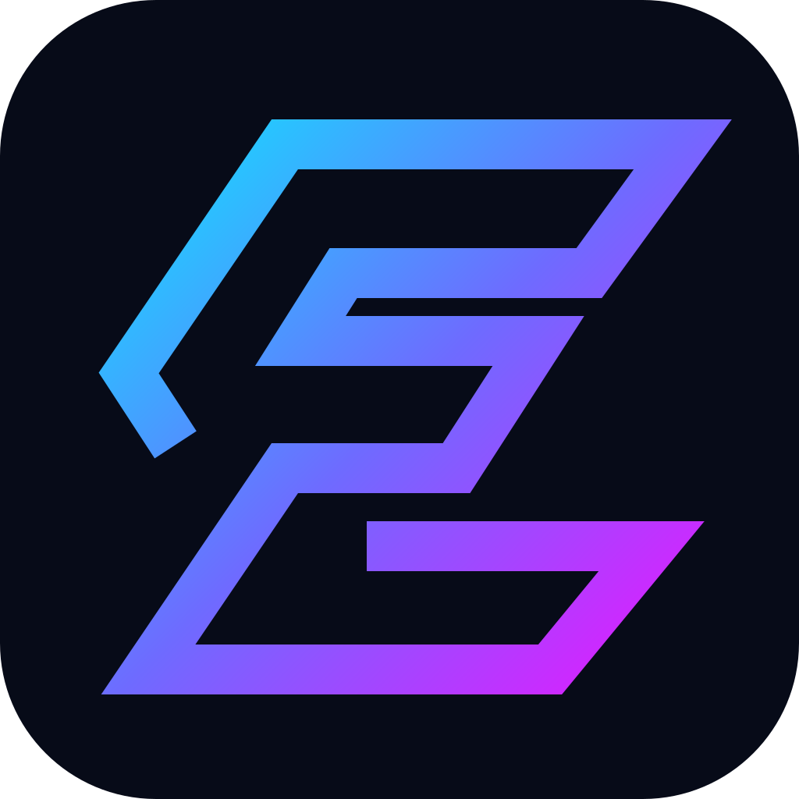

<p align="center"></p>

# EDGEFORGE — Master your edge.

**Trading intelligence platform.** EDGEFORGE starts with the part everything else depends on: an accurate trade journal and analytics engine. AI coaching, backtesting and broker sync come later, built on top of numbers you can trust.

> "EDGEFORGE" is a working name. Trademark and domain availability have not been checked.

## What's built (Phase 1: core journal)

| Area | Status |
| --- | --- |
| Accounts & authentication (email/password, per-user data isolation) | ✅ |
| Trading accounts with currency and starting balance | ✅ |
| Manual trade journal: entry/exit, stop, target, fees, multiplier, setup, strategy, emotion, rule adherence, confidence, notes, screenshot link | ✅ |
| Automatic per-trade results: gross/net P&L, initial risk, R multiple, planned reward:risk, holding time | ✅ |
| CSV import with preview, row-level validation, broker column aliases and duplicate detection | ✅ |
| Dashboard: net P&L, win rate, profit factor, max drawdown, expectancy, payoff ratio, average R, streaks, equity curve, daily P&L | ✅ |
| Strategy breakdowns by setup, instrument, weekday, rule discipline and emotional state | ✅ |
| Rule-based insights, each showing the data behind it | ✅ |
| Time-zone setting: trading days, calendar, rules, weekday/hour stats and CSV imports follow your local time | ✅ |
| P&L calendar with daily and weekly totals | ✅ |
| Risk rules per account (daily loss limit, max trades per day, max risk per trade) with automatic breach detection, a live "today" guardrail and the cost of rule-breaking | ✅ |
| Position-size calculator (risk % or amount, lot step, multiplier, target) | ✅ |
| Journal search and filters (setup, outcome, dates), filtered stats, pagination | ✅ |
| CSV export (re-importable, with calculated columns) | ✅ |
| Self-updating: new-version banner, live data sync across tabs and devices, live prices on open trades, automated dependency updates | ✅ |
| AI coach, backtesting & replay, broker API sync, subscriptions | Planned (phases 3–5) |

## How the numbers are calculated

All money math uses decimal arithmetic (`decimal.js`), not floating point. The engine is in [`src/lib/analytics`](src/lib/analytics) and covered by tests.

- **Gross P&L** = (exit − entry) × quantity × multiplier, sign reversed for shorts.
- **Net P&L** = gross P&L − fees. Every statistic uses net P&L.
- **Initial risk** = |entry − stop| × quantity × multiplier. **R multiple** = net P&L ÷ initial risk (only for trades with a stop).
- **Win rate** = winning trades ÷ all closed trades (breakevens count as non-wins).
- **Profit factor** = total winning P&L ÷ |total losing P&L|. Shown as "—" when there are no losses.
- **Expectancy** = average net P&L per closed trade.
- **Max drawdown** = largest peak-to-trough fall of the equity curve, starting from the account's starting balance. The percentage is relative to the peak.
- **Date ranges**: the curve starts at the balance on the range's first day (starting balance plus everything realised before it).
- Open trades (no exit) are listed in the journal but excluded from statistics.
- Statistics never mix currencies. "All accounts" only appears when every account uses the same currency.
- Trading days, the calendar, risk rules and weekday/hour breakdowns use the time zone in **Settings** (UTC by default). Individual timestamps are shown in each viewer's device time zone.
- **Risk rules** are checked per account: *max risk* compares each trade's initial risk with the limit; *max trades* flags every trade beyond the limit on a trading day (by entry time); *daily loss* flags trades opened after that day's realised net P&L reached the limit.
- **Position size** = risk budget ÷ (|entry − stop| × multiplier), rounded *down* to the size step, so the loss at the stop never exceeds the budget (fees and slippage excluded).
- Insights only use groups with at least 5 closed trades, and present correlations, not diagnoses.

## Self-updating

EDGEFORGE keeps itself current in four ways:

| What | How it works |
| --- | --- |
| **New versions** | Each build has an id (from `APP_BUILD_ID`, the git commit, or the package version). Open tabs check `/api/version` every 5 minutes and when you return to the tab. If a newer build is live they show *"A new version of EDGEFORGE is available"* with a Reload button. Next.js `deploymentId` also makes an outdated tab hard-reload on its next navigation instead of erroring. |
| **Live data** | Every change to accounts, trades or imports bumps a per-user version (`sync_state` table). Pages poll `/api/sync` every 15 seconds while visible and re-render when it moves, so a trade logged on your phone appears on your laptop. Tabs in the same browser update immediately. Forms you're typing in are never refreshed under you. |
| **Live prices** | Open trades on the dashboard show the latest price and unrealised P&L (after fees), refreshed every 20 seconds. Crypto pairs (e.g. `BTCUSDT`) use Binance's public API, no key needed. Stocks and forex use [Finnhub](https://finnhub.io) when `FINNHUB_API_KEY` is set. Futures and other contracts (multiplier ≠ 1) are never priced by guessing a same-named ticker. Prices are cached for 15 seconds per server. |
| **Dependencies** | Dependabot opens grouped weekly pull requests for npm packages (monthly for GitHub Actions), only for releases that have been public for 14 days. CI runs migrations, lint, typecheck, tests and a production build on every pull request. |
| **Database** | `npm run vercel-build` (used automatically by Vercel) and `npm run start:migrate` apply pending migrations before the new version starts. |

## Tech stack

Next.js 16 (App Router, Server Actions) · React 19 · TypeScript · Tailwind CSS 4 · PostgreSQL + Prisma 7 · Better Auth · TradingView Lightweight Charts · Zod · Papa Parse

UI primitives are small hand-written Tailwind components in [`src/components/ui.tsx`](src/components/ui.tsx) rather than shadcn/ui, to keep Phase 1 lean.

## Getting started

Requirements: Node.js 20.9+ and PostgreSQL 14+.

```bash
npm install
cp .env.example .env          # set DATABASE_URL and BETTER_AUTH_SECRET
npm run db:migrate            # create the schema
npm run dev                   # http://localhost:3000
```

Sign up, add a trading account, then log trades or import [`samples/sample-trades.csv`](samples/sample-trades.csv). It contains fictional, illustrative trades. Download the import template from the Import page.

### Scripts

| Command | Purpose |
| --- | --- |
| `npm run dev` / `build` / `start` | Develop / build / serve |
| `npm test` | Unit tests for the analytics engine and CSV importer |
| `npm run lint` · `npm run typecheck` | Static checks |
| `npm run db:migrate` · `db:deploy` · `db:generate` | Prisma migrations (dev / production) and client generation |
| `npm run sample:csv` | Regenerate the sample CSV |
| `npm run start:migrate` · `npm run vercel-build` | Apply migrations, then start / build (for deploys) |

## Security

- Every query and mutation goes through `requireUser()` ([`src/lib/session.ts`](src/lib/session.ts)) and is scoped by the signed-in user's id. Server Actions re-check authorization themselves. The proxy redirect is only a convenience.
- Passwords are hashed by Better Auth. Sessions use HTTP-only cookies.
- EDGEFORGE never asks for broker credentials. Imports are files the user chooses to upload, validated row by row before anything is saved.
- `/api/prices` only looks up symbols from the user's own open trades, so it can't be used as an open market-data proxy.
- Before a commercial launch: add rate limiting in front of the auth endpoints, email verification, password reset, a Content Security Policy, and an external security review.

## Project layout

```
prisma/                 schema and migrations
src/lib/analytics/      trade math, metrics, insights (+ tests)
src/lib/import/         CSV parsing and validation (+ tests)
src/lib/prices/         market-data routing, providers, caching (+ tests)
src/lib/data/           data access (always user-scoped)
src/app/(auth)/         sign in / sign up
src/app/(app)/          dashboard, journal, import, accounts
src/components/         UI primitives, charts, logo
```

## Roadmap

1. **Core journal** ✅ accounts, manual entry, CSV import, calculations, dashboard
2. **Analytics** ✅ time zone, calendar, risk rules, position sizing, filters, export · next: tags, screenshot uploads, custom date ranges, PDF reports
3. **Intelligence** — AI coach with structured access to calculated statistics (every claim cites trades), deeper psychology tracking
4. **Advanced tools** — backtesting and replay, broker and exchange integrations with reconciliation, mobile polish
5. **Commercial launch** — subscriptions (proposed Free / Pro R199 / Elite R399 / Team; prices to be tested), onboarding, security review, support

---

EDGEFORGE is a journaling and analytics tool, not financial advice.
